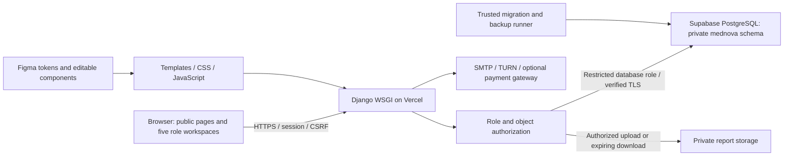

# Supabase target architecture and safe operations

Status: **PASS for local PostgreSQL compatibility; BLOCKED for hosted Supabase**. Connected discovery returned no projects. The available organization is JAYESH V NIMSE; the intended project, region and cost authorization remain unanswered. No hosted database, paid service or production project was created. The working MySQL database remains unchanged and is still the primary local application database.

## Architecture decision

Retain Django5.2, templates/vanilla JS, session authentication, Argon2 passwords and all five roles. Use Supabase PostgreSQL as the proposed managed database, a private mednova schema for Django, and private persistent report storage. Vercel hosts the Django WSGI application and public static assets; it does not host PostgreSQL. No browser Supabase client or second user directory is introduced. Supabase Auth/Edge Functions would require a separate migration of session, role, approval, reset, audit, transaction and clinical ownership behavior, with no current benefit over retaining the tested backend.



This is a supported architectural direction, not a verified hosted installation. Current official [Django-on-Vercel guidance](https://vercel.com/docs/frameworks/full-stack/django) supports WSGI discovery and static collection. [Django5.2 supports PostgreSQL](https://docs.djangoproject.com/en/5.2/ref/databases/#postgresql-notes). A real Linux build, Supabase connection/pooler/TLS, provider storage and HTTPS application acceptance are still required.

## What was actually rehearsed

- Official EDB PostgreSQL18.6 Windows archive downloaded from the vendor-linked endpoint and verified against its SHA256 sidecar. No Windows service or external network listener was installed; the isolated cluster listens at127.0.0.1:54329.
- All20 Django migrations, including care0001–0005, applied to a new database mednova_pg_rehearsal/private mednova schema.
- A private current MySQL JSON export loaded596 objects into this isolated local schema. Complete canonical comparisons matched every exported ID, field, relationship and Django password hash. The source MySQL database was neither dropped nor overwritten. This local test copy includes sessions for comparison; it is not an approved external staging dataset.
-120 PostgreSQL tests passed, including four actual concurrency tests. Eight actual HTTP workflows passed through Waitress on port8002 using mednova_pg_runtime, a non-superuser without BYPASSRLS. The31-table backup restored to a separate empty mednova_pg_restore_qa database with matching row counts.
- RLS enabled and forced on all31 private-schema tables; local simulated anon/authenticated/service_role roles could not read the schema. With temporary read grants in a rolled-back isolated restore transaction, anon/authenticated returned no rows under RLS; the simulated service_role had BYPASSRLS and bypassed RLS as expected. Its protection is revoked grants and secret custody, not RLS. The restricted backend could read/write through its backend-only policy. Hosted Supabase JWT/API/storage policy tests and security/performance advisors remain BLOCKED because no project is selected.

Evidence: verification/postgres-migration-rehearsal.json, postgres-migrations.txt, postgres-rls-rehearsal.json, postgres-backup-restore.json and transformation-postgres-tests.txt. Full actual columns, source-to-target types, keys and counts: [POSTGRES_SCHEMA_INVENTORY.md](POSTGRES_SCHEMA_INVENTORY.md). This inventory is local PostgreSQL, not an invented hosted Supabase schema.

## Environment and connection setup

MySQL remains the default. PostgreSQL is an explicit opt-in:

```text
DATABASE_VENDOR=postgresql
PGHOST=<approved provider or pooler host>
PGPORT=<provider session-pooler or direct port>
PGDATABASE=<intended database>
PGUSER=<restricted backend connection username>
PGPASSWORD=<private server-side secret>
PGSCHEMA=mednova
PGSSLMODE=verify-full
PGSSLROOTCERT=<approved provider CA file path>
```

Use exact values from the project's Connect panel, not a guessed project hostname or username. Inspect [Supabase connection guidance](https://supabase.com/docs/guides/database/connecting-to-postgres) and test the chosen route from Vercel. An IPv4-compatible session-pooler endpoint is the conservative first rehearsal target for this Django configuration; confirm startup options/search_path compatibility with that exact endpoint. Use an appropriate direct/session connection for migrations and backups. A transaction pooler needs an additional explicit compatibility check; do not assume session SET operations survive transaction pooling.

The search path names only the selected application schema, so a missing private schema cannot silently fall back to public tables. The adapter closes persistent app connections (CONN_MAX_AGE0), disables server-side cursors and prepared statements, bounds connection and statement timeouts, and uses a validated private schema identifier. Production requires verify-full plus a CA path. No password belongs in DATABASE_URL, command arguments, source, logs or frontend code. The operator must verify the actual CA/hostname connection, not merely that these environment names exist.

Vercel still needs APP_ENV=production, stable DJANGO_SECRET_KEY, exact ALLOWED_HOSTS/PUBLIC_ORIGIN/CSRF_TRUSTED_ORIGINS, trusted proxy configuration, private storage and provider credentials described in VERCEL_DEPLOYMENT.md. MEDNOVA_TEST* flags are forbidden there. The repository retains mysqlclient for supported MySQL installations; the actual Vercel Linux dependency build has not been verified. Do not silently replace either database driver if that build fails.

## Schema creation, roles and RLS

Only a trusted migration runner may use schema-owner credentials. On the identified empty staging target, create mednova owned by the migration identity; create a separate LOGIN runtime role with a privately provisioned password, no superuser, no BYPASSRLS, no role creation, and no schema ownership/CREATE grant. Do not put passwords in SQL history. Do not add the private mednova schema to exposed Data API schemas.

```powershell
python manage.py check --deploy --fail-level WARNING
python manage.py migrate --plan
python manage.py migrate --noinput
python manage.py secure_postgres --runtime-role mednova_runtime
# Review the generated privilege/policy preview, then:
python manage.py secure_postgres --runtime-role mednova_runtime --apply
python manage.py showmigrations --plan
```

The security command acts only on the private mednova schema, checks that the runtime role exists without superuser/BYPASSRLS, revokes PUBLIC and existing Supabase API role access, grants backend DML/sequence use, enables+forces RLS, and creates a policy restricted to the named backend role. It does not create identities, reset passwords or grant browser access. Run it after each schema migration and verify all newly created tables. This is version-controlled backend-only policy configuration; there is deliberately no auth.uid() policy claiming Django users are Supabase Auth users.

The backend policy permits server operations; Django enforces patient/assigned-doctor/role restrictions on each request. It is **not per-patient database isolation from a compromised backend**. Anyone with the backend password has broad application-schema access. Browser/API roles receive no access, even when signed into Supabase Auth. Test that explicitly, run hosted security/performance advisors, and investigate all findings before release. A separate decision is needed before exposing any table through Supabase APIs. [Grants and RLS are distinct security layers](https://supabase.com/docs/guides/api/securing-your-api).

Switch back to restricted runtime credentials before starting the web application. Verify check_database, all five roles, object ID tampering, unauthenticated access and direct Data API denial. Never run Django as the Supabase postgres owner or use a service-role key in browser code.

## Safe migration and rollback

1. Identify the intended source and destination; record their identities without passwords. Take and verify MySQL and report-file backups. Rehearse only on an empty local/test destination first. Existing production data is never reset.
2. Apply the same version-controlled Django migrations to the target schema. Do not feed MySQL DDL into PostgreSQL. UUID char32 becomes UUID, tinyint booleans become boolean, decimal becomes numeric, and timezone-aware Django datetimes become PostgreSQL timestamptz. Exact types/constraints are recorded in the inventory.
3. Export an approved dataset using dumpdata with natural foreign keys, excluding contenttypes/auth.permission. For **external staging use fresh synthetic records**, not this laptop's existing dataset. For a later approved production migration, deliberately exclude transient sessions/signals/rate buckets and require fresh sign-in; preserve clinical, payment, stock, user and audit records. Do not mistake a staging export for consent to transmit real patient data. MySQL/PostgreSQL collation and case-sensitive uniqueness differ: retain Django account normalization and test Unicode names/email behavior on the actual target. The local cluster uses C locale, not a claim about the eventual hosted collation.
4. Load only into an empty destination. Compare model counts, all IDs/FKs, password hashes and representative normalized values; check sequence resets, orphan counts and duplicate/overlap invariants. The local rehearsal compared all596 exported objects exactly.
5. Test workflows, concurrent writes, RLS, backup/restore, storage objects and migration history. Run the hosted advisors. Only after verified staging acceptance schedule a production cutover with a write freeze, final export, reconciliation, backups and a defined rollback point.
6. Switch environment configuration only after the checks pass. Keep the original MySQL database and backup intact. Rollback to MySQL is safe before accepting new writes on PostgreSQL; after new writes, reconcile them before switching back. Never restore over either live database blindly.

Existing Django Argon2 hashes remain compatible because Django authentication is retained; do not import them into Supabase Auth as though the identity systems were interchangeable. Generate a new environment-specific Django secret for staging, and do not copy active production sessions.

## Database visibility and editing

The MedNova admin portal links to the new schema explorer and existing validated entity workflows. Schema search/detail never queries password hashes, session contents or clinical bodies. Records stay behind specific user/department/inventory/appointment/settings forms, their validators and audit events. Protected medical/payment/audit records are retained; safe account removal is deactivation. There is no general SQL console or unconstrained CRUD editor.

In the **identified Supabase Dashboard**, select the private mednova schema in Table Editor if your project permissions/UI support it. Table Editor/SQL Editor are privileged DBA tools, not ordinary hospital-admin access. Avoid row previews of users, sessions or clinical tables unless operationally authorized. If the private schema is not listed, use an authorized direct SQL client; do not expose it to the Data API to make a UI listing appear.

Reviewed SQL Editor queries (metadata/non-clinical projections only):

```sql
SELECT current_database(), current_user, current_schema();
SELECT tablename FROM pg_tables WHERE schemaname = 'mednova' ORDER BY tablename;
SELECT column_name, data_type, is_nullable
FROM information_schema.columns
WHERE table_schema = 'mednova' AND table_name = 'care_department'
ORDER BY ordinal_position;
SELECT indexname, indexdef FROM pg_indexes WHERE schemaname = 'mednova';
SELECT tablename, policyname, roles, cmd, qual, with_check
FROM pg_policies WHERE schemaname = 'mednova';
SELECT id, name, active FROM mednova.care_department
WHERE name ILIKE '%cardio%' ORDER BY name LIMIT 25;
```

Manual UPDATE rehearsal defaults to ROLLBACK; prefer the audited app form:

```sql
BEGIN;
SELECT id, opening_hours FROM mednova.care_hospital WHERE id = 1 FOR UPDATE;
UPDATE mednova.care_hospital SET opening_hours = 'Training rehearsal only'
WHERE id = 1 RETURNING id, opening_hours;
ROLLBACK;
```

Scratch insert/delete only in an isolated training database, never a clinical entity:

```sql
BEGIN;
INSERT INTO mednova.care_department(name, description, active)
VALUES ('SYNTHETIC SQL REHEARSAL', 'Uncommitted exercise', true)
RETURNING id; -- use this exact returned ID below
DELETE FROM mednova.care_department
WHERE id = 123456 AND name = 'SYNTHETIC SQL REHEARSAL'
RETURNING id; -- replace123456 with the actual scratch ID, inspect affected rows
ROLLBACK;
```

Identity/sequence counters can advance even after ROLLBACK; gaps are normal. Never broaden WHERE after an unexpected result, disable FK checks, or manually change password hashes, roles, stock, clinical records or payment states. These have multi-record invariants and audit requirements.

## PowerShell, backups and the existing local rehearsal

```powershell
Set-Location 'C:\Users\Niraj\Downloads\mednova-redesign\MedNova-Python-MySQL'
.\.venv\Scripts\python.exe tools/local_mysql.py serve    # primary existing MySQL app:8000
# In another terminal, for the already initialized local rehearsal cluster:
.\.venv\Scripts\python.exe tools/local_postgres.py serve # restricted PostgreSQL rehearsal:8002
.\.venv\Scripts\python.exe tools/local_postgres.py check_database
.\.venv\Scripts\python.exe tools/local_postgres.py database_inventory --output .runtime/postgres-schema.json
```

The local helper uses ignored private configuration, starts the already initialized loopback cluster if needed, and never creates/resets a database. `--operator` is an explicit local management mode; web serving with it is refused. For a new machine use the documented approved database setup, not copied .runtime passwords. MySQL instructions remain in MYSQL_OPERATIONS.md.

For an authorized hosted/local operator connection use psql's prompt (no password arguments):

```powershell
psql --host=$env:PGHOST --port=$env:PGPORT --username=$env:PGUSER --dbname=$env:PGDATABASE --password
```

Set PGSSLMODE=verify-full and PGSSLROOTCERT to the approved provider CA for hosted operations. Use a backup identity that can read all intended rows under RLS; do not bypass permissions by running the web server as that identity. Backups contain sensitive rows and hashes: store encrypted/private with controlled retention, never in Git.

```powershell
pg_dump --host=$env:PGHOST --port=$env:PGPORT --username=$env:PGUSER --password --format=custom --no-owner --file=C:\approved\private\mednova.dump $env:PGDATABASE
if ($LASTEXITCODE -ne 0) { throw 'Backup failed' }
Get-FileHash -Algorithm SHA256 -LiteralPath C:\approved\private\mednova.dump
# Create a NEW empty restore database through an authorized operator first.
pg_restore --host=$env:PGHOST --port=$env:PGPORT --username=$env:PGUSER --password --no-owner --exit-on-error --dbname=mednova_restore_review C:\approved\private\mednova.dump
```

Do not add --clean or restore into the live database. Validate all tables/counts/FKs and application workflows in isolation. A local31-table restore passed; hosted Supabase backup/PITR and object-storage recovery are NOT TESTED. Back up report object bytes/versions separately and reconcile them with the database snapshot.

## Reports and initial administrator

The existing S3 storage adapter supports a custom HTTPS endpoint, path-style addressing, private objects and60-second signed downloads after Django authorization. Proposed Supabase storage uses endpoint/region/S3 keys from its Dashboard and a private reports bucket. Generated S3 access keys bypass storage RLS across buckets; keep them server-side and isolate the medical-storage project. Do not use a publishable/service-role key as an S3 secret. Read [official Supabase S3 authentication guidance](https://supabase.com/docs/guides/storage/s3/authentication). Upload, signed GET, expiration, denied access and object restore must pass against the real target before enabling it. No bucket or external file migration was performed.

The intended human administrator email and local/staging destination are still unanswered. Do not infer them from a connected-tool account or an existing patient. Once confirmed, use the supported one-time command with a fresh hidden password:

```powershell
$env:MEDNOVA_ADMIN_EMAIL = Read-Host 'Verified administrator email'
python manage.py ensure_admin
Remove-Item Env:MEDNOVA_ADMIN_EMAIL
```

For this laptop use tools/local_mysql.py or tools/local_postgres.py in place of manage.py for the chosen environment. A trusted hosted runner may inject temporary MEDNOVA_ADMIN_EMAIL/MEDNOVA_ADMIN_PASSWORD and run `python manage.py ensure_admin --noinput`; remove those bootstrap secrets afterward. Repeating it never resets a valid administrator or promotes a conflicting account. New administrators must replace the initial password before workspace access. Synthetic provisioning/login/role-denial tests passed on all three test backends.
